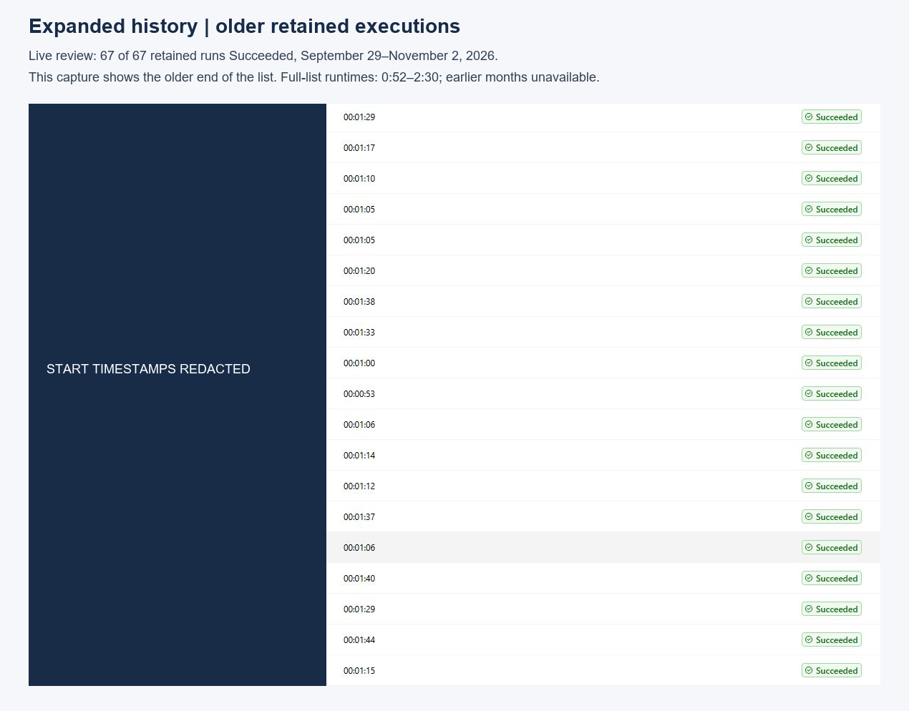
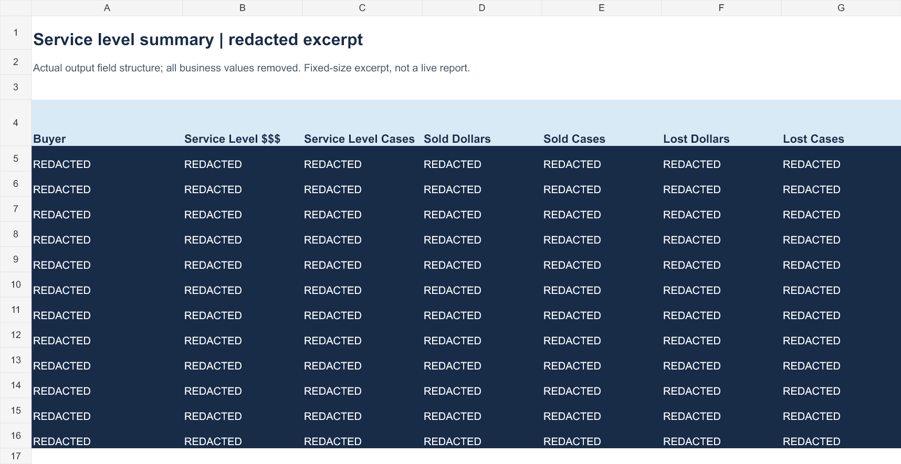

# Lost-sales reporting automation

I built this Power Automate workflow for procurement buyers and department leadership to turn incoming lost-sales data into Excel reports they can use to review service performance and exceptions. This example shows the meat reporting workflow.

## The problem I solved

Preparing each report previously took about an hour of manual data import, reconciliation and workbook setup. The process also lacked an automated failure notification, so a reporting issue could go unnoticed until someone checked the output.

## What I built

I translated the reporting process and buyer/vendor mapping rules into a workflow using Power Automate, Outlook, SharePoint and Excel Office Scripts. It captures incoming attachments, processes the source data, applies the mappings, builds the report and service-level summary, and distributes the output.

I also added failure notifications with dynamically populated diagnostic details sent to me and my manager. Those alerts give us a specific issue to investigate when a run fails.

## Python verification agent

I added a Python verification agent alongside the Power Automate workflow to check file integrity during transfer, verify the generated report output and reconcile it against the pulled source data. This gives the workflow a separate verification step beyond whether the reporting flow completed successfully.

If a file-integrity, output-verification or reconciliation check fails, the agent alerts me with diagnostic details so I can identify the failure point and investigate. Power Automate handles the reporting flow; the Python agent handles these verification checks and diagnostic alerts.

## Results

I now complete report preparation and review in **about five minutes, including the automated run**, compared with roughly an hour of manual preparation previously.

The reports reconcile **within 1% of verified source totals** from the pulled lost-sales data.

The reports are the company-accepted standard for lost-sales and service-level reporting within their departmental scope. They support quarterly reporting and company-wide outreach.

The retained Power Automate history reviewed on November 2, 2026 contains **67 executions, all marked Succeeded**, from **September 29 through November 2**. Across those runs:

- Average execution time: **about 1 minute 17 seconds**.
- Shortest execution: **52 seconds**.
- Longest execution: **2 minutes 30 seconds**.

The roughly one-hour baseline and five-minute total are my estimates of the reporting effort. The execution times above measure the automated run itself; the five-minute total includes my review. The retained run history covers September 29 through November 2, 2026.

## Walk through the workflow

| File | What it shows |
| --- | --- |
| [Report-generation flow](01-report-flow.png) | File trigger, conditional processing, Excel scripts, report creation and email actions |
| [Email-intake flow](03-email-intake.png) | Incoming email, attachment retrieval and file handling |
| [Original run-history screenshot](02-run-history.png) | A closer view of 10 successful runs, taking 1:08–1:35 |
| [Expanded run history](06-expanded-history.png) | The older end of the retained execution list |
| [Execution list](retained-executions-redacted.csv) | Duration and status for all 67 retained runs, with identifiers and timestamps removed |
| [Run-history notes](RELIABILITY.md) | The review method and coverage of the retained history |
| [Report summary](04-excel-summary.png) and [report detail](05-excel-detail.png) | Sanitized examples of the report's field structure |
| [Excel excerpt](sanitized-report-excerpt.xlsx) | Summary and detail headings with every business value replaced by REDACTED |

## About the shared files

I am sharing the workflow structure and report format with confidential business information removed. The Excel file is a static, rebuilt excerpt with placeholder rows; it contains no production values, formulas, source data or connections. Internal script labels and identifying details are masked in the screenshots. The underlying production code and mapping rules are not included.

[Download the evidence package](lost-sales-evidence-package.zip) to view the screenshots and offline gallery together. The archive contains the original supporting documentation; this README is my current project overview.
